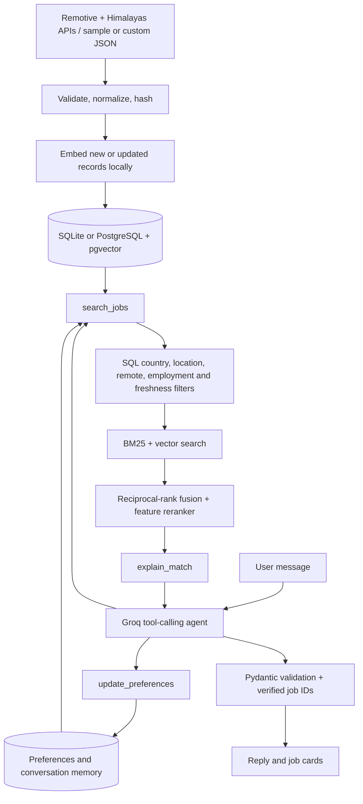

# Waypoint — Job Matching Agent

A conversational job search application using **Groq**, FastAPI, local MiniLM embeddings, BM25, hybrid retrieval, persistent preferences, and conversation memory. No OpenAI API key is needed.

## Start locally

Python 3.12 recommended. Clone the repository and start the application:

```bash
git clone https://github.com/satyamk1234/waypoint.git
cd waypoint
./scripts/dev.sh
```

The setup script creates a virtual environment, installs dependencies, downloads the local embedding model, imports sample jobs, and starts the server. Public job feeds refresh in the background. Open http://127.0.0.1:8000.

For conversational chat, create a key at https://console.groq.com/keys. Stop the server with Ctrl+C, then run:

```bash
.venv/bin/python scripts/set_groq_key.py
.venv/bin/python -m uvicorn app.main:app --host 127.0.0.1 --port 8000
```

The first command accepts hidden input and saves it to the ignored, owner-only `.env`. Restart after changing `.env`. Search works without a Groq key; chat requires one. Local databases, credentials, model caches, and virtual environments are not included in this repository.

The default `GROQ_MODEL=openai/gpt-oss-20b` is **served by Groq**. Its name does not imply use of the OpenAI API. Groq free-plan availability is subject to account/model rate limits. The app handles 429 errors without automatic retries. Groq chat and preference updates were demonstrated in the running app; automated tests use mocked responses without spending API quota.

## Pipeline



## Import jobs

```bash
.venv/bin/python -m app.ingest --source sample
.venv/bin/python -m app.refresh
# Optional individual import (bounded to 200 listings):
.venv/bin/python -m app.ingest --source himalayas --max-pages 10
.venv/bin/python -m app.ingest --source json --file /absolute/path/jobs.json
```

`data/sample_jobs.json` contains 30 fictional postings. **Real jobs only** is enabled by default; disable it and save preferences to include samples. Both public APIs work without a key. Imports retain provider attribution and original application links, validate the batch, hash content, and embed only new or changed records. Changing the embedding model triggers re-embedding.

A background scheduler refreshes both sources every 24 hours **while the application is running**, and checks for a due refresh when it starts. No operating-system scheduler is installed. `python -m app.refresh` uses the same daily cooldown and process lock. Set `JOBS_REFRESH_ENABLED=false` to disable background refresh. `JOBS_REFRESH_HOURS` has a minimum of 24; `HIMALAYAS_MAX_PAGES=10` imports up to 200 listings per refresh. Optional `HIMALAYAS_API_KEY` supports an account with higher quotas. The interface shows source status and last successful refresh.

Himalayas coverage is a bounded portion of the feed, not its entire catalogue. A partial snapshot never retires jobs merely because they were absent. Missing records are retired only after a validated complete snapshot. Failed imports preserve the previous index. Known-expired listings and real listings not seen for 48 hours are excluded from search. This reduces stale results but cannot guarantee that an employer has not closed a role early. Remotive listings can be delayed by its public-feed policy.

Matching first uses SQL to filter active, fresh listings by saved preferences, then ranks candidates using BM25 and embeddings. **Country eligibility** accepts country names and common aliases such as India/IN and US/USA. It includes explicitly worldwide roles; roles with unknown eligibility are excluded from country-specific searches. **Listed location** is an optional text filter. Remote does not imply worldwide or visa sponsorship; timezone restrictions are displayed in details, not automatically matched. Equivalent application URLs are deduplicated in search results.

During local verification, the first refresh imported **216 real listings: 16 Remotive + 200 Himalayas**. Counts change as feeds refresh and jobs expire. Existing database columns are migrated additively; local backups belong in the ignored `data/backups/` directory.

Provider references: [Himalayas public API](https://himalayas.app/docs/remote-jobs-api), [Remotive guidance](https://github.com/remotive-com/remote-jobs-api).

## PostgreSQL / Docker

```bash
docker compose up --build -d
docker compose exec app python -m app.ingest --source sample
```

Compose provides PostgreSQL 16 with pgvector, an HNSW index, and persistent database/model volumes. The app binds to `127.0.0.1:8000`; the database exposes no host port. The local quick start uses SQLite. Database passwords in Compose are local development defaults; configure `POSTGRES_PASSWORD` for other environments.

Disk exhaustion interrupted Docker verification on this machine. The task's temporary container, database volume, image, and build-cache records were removed to restore space. PostgreSQL execution remains unverified. No public deployment was performed.

## Tests and evaluation

```bash
.venv/bin/python -m pytest -q
.venv/bin/python -m app.evaluate
# Explicitly sends requests to Groq after key setup:
.venv/bin/python -m app.evaluate_agent --live --limit 5
```

23 backend tests passed, covering incremental ingestion, retirement, hard filters, session isolation, preference clearing, tool execution, schema recovery, fabricated-ID rejection, missing credentials, rate limits, and HTTP routes. Live-feed tests also cover pagination, partial snapshots, refresh cooldowns/failures, country eligibility, expiry/staleness, URL deduplication, and migration preservation.

Retrieval evaluation uses an isolated in-memory index, 30 fictional jobs, and 30 explicitly authored relevance fixtures. It writes `reports/retrieval.json`. These are synthetic development checks, **not an independent real-world benchmark or human-labelled live dataset**.

Observed MiniLM results at k=5:

| Method | Recall@5 | nDCG@5 |
| --- | ---: | ---: |
| BM25 | 0.9667 | 0.9667 |
| Vector | 1.0000 | 1.0000 |
| Hybrid RRF | 0.9889 | 0.9833 |
| Feature rerank | 0.9667 | 0.9522 |

Vector search performed best on these fixtures. The reranker uses title/skill overlap; it is not a learned cross-encoder, and these results do not show a reranking improvement. All four modes are available through the search API.

Live agent evaluation reports first-response JSON validity, final grounded responses, and failed requests, using your Groq quota. No live validity rate is claimed until it has run. `EMBEDDING_BACKEND=hash` is an offline lexical test baseline, not semantic search; default `fastembed` uses local 384-dimensional MiniLM embeddings. Re-import after changing the embedding backend. Different embedding models are never mixed in retrieval.

## API and implementation

Interactive docs: http://127.0.0.1:8000/docs

| Endpoint | Purpose |
| --- | --- |
| `GET /api/health` | Index size and configuration status; no secrets |
| `POST /api/sessions` | Issue an opaque browser session token |
| `GET/PATCH /api/preferences` | Read/save explicit preferences |
| `POST /api/search` | Query, limit, and retrieval mode |
| `POST /api/chat` | Bounded Groq tool loop |
| `GET /api/history` | Recent conversation |
| `DELETE /api/session` | Erase this session's messages and preferences |

Session endpoints use `X-Session-ID`; the browser stores the token locally. This is a local demo identity mechanism, not production login. Chat sends recent conversation, preferences, and job snippets to Groq. Local search itself sends no personal data to an LLM. Run one worker; a process-local lock permits one chat request at a time.

Tables: `jobs`, `users`, `preferences`, `messages`, `source_refresh`. PostgreSQL handles vector nearest-neighbour queries; BM25 scans the filtered corpus in Python. This is an MVP, not web-scale retrieval. Before public deployment add authentication, quotas, HTTPS, schema migrations, and managed/persistent storage.

- `app/agent.py`: Groq adapter, validated tools, bounded agent loop.
- `app/search.py`: BM25, vector search, fusion, feature reranking.
- `app/ingest.py`: normalized incremental imports and Remotive adapter.
- `app/sources.py`: Himalayas adapter and bounded pagination.
- `app/refresh.py`: daily scheduling, source status, and process lock.
- `app/locations.py`: country normalization and eligibility metadata.
- `app/db.py`: schema, additive metadata migration, and pgvector setup.
- `app/main.py`: API routes and sessions.
- `app/static/`: responsive interface, search, preferences, chat, job details.
- `app/evaluate.py`, `app/evaluate_agent.py`: evaluation entry points.
- `data/`: sample jobs and query/relevance fixtures.
- `tests/`: backend tests.
- `requirements.lock`: exact versions installed during verification.

References: [Groq tool calling](https://console.groq.com/docs/tool-use/local-tool-calling), [models](https://console.groq.com/docs/models), [rate limits](https://console.groq.com/docs/rate-limits), [FastEmbed](https://github.com/qdrant/fastembed), [pgvector](https://github.com/pgvector/pgvector).
